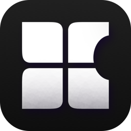

  

<h1 align="center">BCD</h1>

  <b>Windows games on iPhone and iPad.</b> 
  A fast, controller-friendly launcher with Steam, GOG and Epic Games built in. 
  Alpha: early development, before beta. Many games run, many do not yet.

  <a href="https://github.com/thebcd69/bcd-games/releases/latest/download/BCD.ipa"><b>Download the IPA</b></a>
  &nbsp;·&nbsp; <a href="#install">Install</a>
  &nbsp;·&nbsp; <a href="#games">Games</a>
  &nbsp;·&nbsp; <a href="https://discord.gg/43TmupTVug">Discord</a>
  &nbsp;·&nbsp; <a href="#credits">Credits</a>

  
  
  
  

<table>
  <tr>
    <td></td>
    <td></td>
  </tr>
  <tr>
    <td></td>
    <td></td>
  </tr>
</table>

*Crysis 2 Remastered (Steam), recorded on an iPhone 17 Pro Max.*

*Grand Theft Auto V Legacy (Steam), recorded on an iPhone 17 Pro Max.*

*Marvel's Spider-Man Remastered, recorded on an iPhone 17 Pro Max.*

BCD runs Windows PC games on iOS and iPadOS. Wine provides Windows, FEX runs x86 and
x64 code on Apple's chips, and DXMT plus BCD's Direct3D 12 runtime draw with Metal. BCD
signs in to Steam, downloads the games you own, and starts them directly or through
Valve's own Steam client (BCD Dock).

BCD is a fork of [Madeira](https://github.com/willfaust/Madeira) by Will Faust and its
contributors (see [Credits](#credits)).

### Free Apple ID

A free Apple ID keeps only three sideloaded apps active at once. BCD, StikDebug (where you need it for
JIT) and SideStore or AltStore can fill all three. The usual way around it is **LiveContainer**, which
runs more apps inside one container. A typical setup: GetMoreRam gives LiveContainer the Increased Memory
Limit entitlement (you can remove GetMoreRam afterwards), StikDebug provides JIT, and BCD runs inside
LiveContainer. If something breaks inside LiveContainer, try BCD outside it before you report a problem.

## What it does

- **A whole new app around the games:**
  - your library with store cover art, search, sorting and a menu on every card;
  - a page for each game with all its settings in one place;
  - the controller works everywhere: every screen, the in-game menu, the touch-controls editor;
  - a lightweight in-game menu, performance overlay and on-screen touch controls.
- **Steam:** sign in (password with Steam Guard, or a QR code), your owned library,
  downloads and updates, file checks, Steam Cloud saves, and the DLC you own: choose it
  before the install, add or remove it later on the game's page. Downloads keep going in
  the background on iOS 26.
- **Epic Games Store** (new, early): sign in, install your Epic games and start them signed
  in to your Epic account. BCD says before the install when a game cannot run (Easy
  Anti-Cheat, another company's launcher).
  If the first sign-in stops at a step on Epic's side (for example accepting a new privacy
  policy), sign in at epicgames.com in a browser, finish the step, then sign in to BCD again.
- **GOG** (early): sign in, download and play your GOG games, with no launcher running
  inside Windows.
- **BCD Dock:** Valve's Steam client starts the games that need Steam, without its window.
  Those games run through Valve's own client, signed in with your account.
- **Graphics:** Direct3D 9, 10 and 11 through DXMT; Direct3D 12 through BCD's runtime and
  Apple's Metal Shader Converter.
- **32-bit and 64-bit games**, controllers (DualSense with rumble, adaptive triggers and light
  bar; Xbox; Switch Pro; MFi), keyboard and mouse, and a controller-to-keyboard-and-mouse mode.
- **Recommended settings that stay current:** every known game ships with tuned settings, and
  one tap on a game's page fetches the newest list. Per-game settings also tune themselves
  after a crash.
- **.NET games** through Wine Mono, downloaded in the app.
- **Feedback from the app:** Settings › Feedback to tell us what is broken or what to improve,
  and Send Log after a crash.
- **iPhone Duo (experimental):** on the foldable iPhone, turn on Settings › Graphics › Foldable
  iPhone support (experimental). A game you add then starts at a resolution shaped like the inner
  display, the touch controls follow the screen when you fold or unfold the phone, and BCD uses its
  phone layout in a window narrower than 700 points. Installed directly, iOS shows BCD in a small
  window on the inner display; inside LiveContainer it fills the screen. The switch is off by
  default and changes nothing on other iPhones and iPads.

## Games

Tuned settings are built in for these games. They are the licensed Steam versions, started
through BCD Dock:

- God of War
- Ghost of Tsushima
- Horizon Zero Dawn and Horizon Forbidden West
- Red Dead Redemption 2, including the Rockstar Launcher
- GTA V, Legacy and Enhanced
- Grand Theft Auto IV: The Complete Edition
- Counter-Strike 2
- Crysis Remastered, Crysis 2 Remastered and Crysis 3 Remastered

Also running: Warcraft II: Battle.net Edition. Work in progress: Ratchet & Clank: Rift Apart
(around 20 FPS, with visual glitches).

### Seen running in testers' logs and reports

These games reached gameplay and were played for several minutes in the logs testers sent with
Send Log, or were reported running on the BCD Discord (the device and frame rate are given where
the report had them). None of them was played from start to finish, and results depend on the
device, the iOS version and the settings.

- Aliens versus Predator Classic 2000 (M5 iPad Pro: keyboard and mouse)
- Ancestors: The Humankind Odyssey
- Batman: Arkham Asylum (iPhone 13 Pro Max: default settings, 50-60 FPS)
- Batman: Arkham City (M4 iPad Pro: high settings, 1600x1200, 40-60 FPS)
- Batman: Arkham Knight (M5 iPad Pro: maximum settings, native resolution, 30 FPS)
- Batman: Arkham Origins (M4 iPad Pro: high settings, 1600x1200, 40-60 FPS)
- Call of Duty 4: Modern Warfare (M5 iPad Pro)
- Call of Duty: Black Ops (iPhone 17 Pro)
- Call of Duty: Black Ops II, Zombies mode (iPhone 15)
- Call of Duty: Modern Warfare 3 (iPhone 17 Pro: medium settings, 40-50 FPS)
- Call of Duty: World at War (iPad Air M4)
- Celeste
- Cleared Hot
- Counter-Strike: Source (iPhone 14 Pro)
- Dark Souls II: Scholar of the First Sin
- Dead Rising
- Dead Space (2008)
- DELTARUNE
- Dokimon (iPhone 15 Pro Max)
- Doom 3
- Dragon's Dogma: Dark Arisen (iPhone 17 Pro: 720p with 2x upscaling, mostly 60 FPS)
- Dying Light (iPhone 17 Pro Max)
- The Elder Scrolls V: Skyrim Special Edition (iPhone 15 Pro Max: 14-25 FPS)
- F1 2020 (M5 iPad Pro: native resolution)
- Fallout 4
- Fallout: New Vegas
- Far Cry 2 (iPhone 15 Pro Max: 720p low/medium, 30-60 FPS)
- Far Cry 3
- Final Fantasy VII Remake Intergrade (M5 iPad Pro: low settings, 900p, 30 FPS)
- Fistful of Frags (iPhone 14 Pro: low FPS)
- Half-Life 2 (iPhone 14: 60 FPS)
- Hollow Knight: Silksong (M5 iPad Pro)
- Kingdom Come: Deliverance (M5 iPad Pro: low settings, about 50 FPS)
- Kingdom Hearts III (M5 iPad Pro: highest settings, mostly 60 FPS)
- Left 4 Dead 2 (iPad Air M2: medium settings, online play works)
- Marie's Room
- Marvel's Spider-Man Remastered (iPad Air M3: 23-30 FPS, flickering)
- Megabonk
- METAL GEAR SOLID: Peace Walker - Master Collection Version
- Metro 2033 Redux (iPhone 17 Pro: 60 FPS with tessellation off)
- Metro Exodus (M4 iPad Pro: 1280x720, 30-80 FPS)
- Metro: Last Light Redux (iPhone 17 Pro)
- MiSide
- Moonlighter
- Need for Speed: The Run (iPhone 17 Pro Max)
- NieR:Automata (M5 iPad Pro: lowest settings, 1728x1192, 40-60 FPS)
- No, I'm not a Human (iPad Air M2)
- Outlast (iPhone 17 Pro: about 45 FPS)
- Overcooked! 2 (iPad Air M4)
- Pacific Drive (iPhone 17 Pro: 15-20 FPS)
- PEAK (iPad Air M3: low settings, about 30 FPS)
- Pizza Tower
- PlateUp! (M1 iPad: 40 FPS)
- POSTAL 2 (iPhone 15)
- Requiem: Avenging Angel (iPad M5)
- Rise of the Tomb Raider (iPhone 17 Pro Max)
- Satisfactory (M1 iPad)
- Schedule I (M5 iPad Pro)
- Shadow of the Tomb Raider (M4 iPad Pro)
- Silent Hunter III (M5 iPad Pro)
- Slay the Spire 2
- Sleeping Dogs: Definitive Edition (iPhone 15 Pro Max: 15-30 FPS)
- Sonic Mania
- System Shock 2 (M5 iPad Pro: keyboard and mouse)
- Timberborn
- Tomb Raider (2013)
- ULTRAKILL (iPad Air M4)
- Undertale
- The Witcher 3: Wild Hunt (iPad Air M3, version 1.32: low settings, 40-60 FPS)

How well a game runs varies a lot; many games do not start yet.

## What you need

- **iPhone or iPad on iOS / iPadOS 18 or later, with an A13 chip or newer.** Games that use
  geometry shaders or tessellation need an A14 or newer; the heaviest games need an
  A17 Pro or M-series chip and plenty of memory. Devices with an A12 or older chip are not
  supported (their GPUs lack what Direct3D needs).
- **JIT.** iOS lets only an app a debugger starts generate code, and BCD needs that for
  every game:
  - iOS 26 or later on A15 / M2 and newer: BCD's built-in helper (paired once on the
    device), or StikDebug;
  - iOS 18, and iOS 26 on older chips: StikDebug, with its "Always Run Scripts" setting on.
- **A way to install the IPA:** SideStore or AltStore (a free Apple ID works), LiveContainer,
  or your own signing. More memory for big games: GetMoreRam adds Increased Memory Limit
  to BCD's App ID.
- **Room:** each game needs its full install size on the device.

## Install

1. Get BCD one of two ways:
   - **From the AltStore / SideStore source** (installs BCD and keeps it updated): in AltStore
     Classic or SideStore, add `https://thebcd69.github.io/bcd-games/source.json` under Sources,
     or open the [source page](https://thebcd69.github.io/bcd-games/) on your iPhone or iPad for
     one-tap Add buttons. The source is by [le0-VV](https://github.com/le0-VV).
   - **From the IPA:** download [`BCD.ipa`](https://github.com/thebcd69/bcd-games/releases/latest/download/BCD.ipa)
     from the latest [release](https://github.com/thebcd69/bcd-games/releases) and install it with
     SideStore, AltStore or LiveContainer.
2. Open BCD. Setup walks you through JIT, LocalDevVPN, Steam and the extra runtimes.

## Reporting a problem

1. When a game crashes, freezes or is closed by iOS, BCD's **auto-tune** suggests a fix. It is on
   by default (**Settings › Logs**, and a switch on each game's page). Tap **Close BCD**, open BCD
   again and start the game again. Let it go on, round after round, until it is done.
2. When auto-tune gives up, its message offers **Send Log**. Send that log: it has what is needed
   to look into the game.
3. For ideas and everything else, use **Settings › Feedback**.
4. Install help, game reports and ideas are also welcome on the [BCD-Games Discord](https://discord.gg/43TmupTVug).

## What is not in the package

BCD's packages carry no Microsoft software. The Visual C++ runtime most games need is
downloaded from Microsoft inside the app, after you accept Microsoft's license terms, and
kept unchanged on your device. Wine Mono comes from WineHQ the same way.

## Building

The build is the workflow [.github/workflows/build-ipa.yml](.github/workflows/build-ipa.yml)
and the scripts it runs under `build/` and `tools/`, step by step. Every release also carries
`BCD-source.tar.xz`, the complete source of that release: this repository and all its
submodules at the release's pins.

## License

BCD is free software under the GNU General Public License, version 3 ([LICENSE](LICENSE)),
with the Madeira Converter Exception ([LICENSE-EXCEPTION.md](LICENSE-EXCEPTION.md)).
Madeira's own code is under version 3 or (at your option) any later version; BCD's own
files (marked "BCD Material" in their headers) are under version 3 only, so BCD as a whole
can be used under version 3. They also carry additional terms under GPL-3.0 section 7
([LICENSE-BCD.md](LICENSE-BCD.md)): an app that includes them shows *"Includes work from BCD
by thebcd69 (https://github.com/thebcd69/bcd-games)"* on its About, Credits or Licences
screen, keeps their copyright lines, and marks changed files as modified.
Third-party components and their licences: [THIRD-PARTY-NOTICES.md](THIRD-PARTY-NOTICES.md).
There is no warranty.

Steam is a trademark of Valve Corporation. Epic Games and the Epic Games Store are trademarks
of Epic Games, Inc. GOG is a trademark of GOG sp. z o.o. Windows, DirectX, Direct3D and Visual C++ are
trademarks of the Microsoft group of companies. Apple, iPhone, iPad, iOS, iPadOS and Metal
are trademarks of Apple Inc. BCD is an independent project, not affiliated with or endorsed
by Valve, Epic Games, GOG, Microsoft, Apple or the authors of Madeira. Game titles named here belong to their
respective owners; BCD is not affiliated with or endorsed by them.

## Credits

**Madeira**, which BCD is a fork of:

- **Will Faust** ([willfaust](https://github.com/willfaust)): created Madeira
- **Nick** ([125hz](https://github.com/125hz)): 32-bit game support, the game library and
  Madeira Dock (BCD Dock here)
- **Jfishin** ([Jfishin](https://github.com/Jfishin)): the original native Steam sign-in,
  library and downloads
- **Jesse** ([JesseLovelace](https://github.com/JesseLovelace)): Steam Cloud saves, faster
  game launches, and fixes that let more games run
- **Dan Perks** ([danperks](https://github.com/danperks)): in-app JIT without StikDebug, and
  pairing without a computer
- **spitefulowl** ([spitefulowl](https://github.com/spitefulowl)): Wine and FEX runtime
  fixes, DXMT texture and memory fixes, audio, the swap tier, and library launch options
- **meshoklv** ([meshoklv](https://github.com/meshoklv)): controller fixes, touch taps that
  stay off the mouse, and a crash-guard fix
- **TheHadesc** ([TheHadesc](https://github.com/TheHadesc)): Madeira Dock starts for more
  games, and a touch gamepad that survives the in-game keyboard
- **vancez** ([vancez](https://github.com/vancez)): Steam download checksums, and the idea for
  the download-server fallback in regions without HTTPS servers

**The projects underneath:** [Wine](https://www.winehq.org), [FEX-Emu](https://github.com/FEX-Emu/FEX),
[DXMT](https://github.com/3Shain/dxmt) by Feifan He (3Shain) with the Direct3D 9 frontend by
David Acevedo (dacevedo12), rpmalloc by Mattias Jansson, StikDebug, StikJIT, idevice,
FreeType, and every library listed in THIRD-PARTY-NOTICES.md. Thank you to everyone who
works on them.

**BCD** by thebcd69, with the AltStore and SideStore source by **le0-VV** ([le0-VV](https://github.com/le0-VV)).
